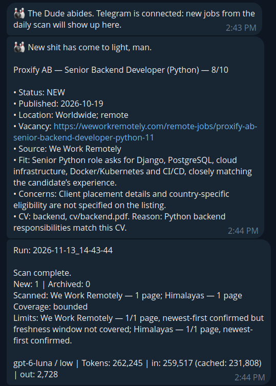

<p align="center">
  
</p>

# dude

[](https://github.com/drucewihlis/dude/actions/workflows/tests.yml)

> The Dude abides. The cron hunts.

A lazy, local AI job-search daemon that pings you on Telegram.

Every morning a timer wakes up an AI agent ([Codex CLI](https://github.com/openai/codex) or
[Claude Code](https://github.com/anthropics/claude-code)). It reads your profile and CVs, walks your
job boards, skips what you've already seen, checks each promising vacancy on the employer's page
and writes a scored shortlist to `NEW.md`. Then it pings you. You read it over coffee. In a
bathrobe, ideally.

<p align="center">
  
</p>

One message per new job, then a run summary with the bill. A real run on a cheap model, for the
fictional candidate from the example profile.

## What it does

- **Runs while you sleep.** Starts at a set hour; if the laptop was asleep, catches up on wake.
  One successful run per day.
- **Scans only your sources.** Public feeds and APIs where possible, a headless browser where not,
  within a page budget per source.
- **Remembers.** Applied, skipped and rejected jobs go into a local index, so you never see the
  same job twice.
- **Verifies.** Checks date, allowed countries, remote policy and whether the job is still open on
  the employer's page. A board's "worldwide" label doesn't count.
- **Picks the CV** that fits each vacancy, if you have several.
- **Learns.** Working endpoints for each board are saved to `config/recipes.md`, so later runs are
  faster and cheaper.
- **Reports honestly.** A partial or capped scan says so. Every summary shows tokens spent (and
  USD on Claude Code).

- **Drafts applications when you ask.** Send a vacancy link to `/abide` and get the CV to use,
  answers for every form field and a cover letter. You press Submit.

It never applies, never messages employers and never edits your CVs. The rest is up to you, man.

## How it works

```text
timer ──▶ dude.sh ──▶ codex exec  or  claude -p
                     │            ├─ reads  config/profile.md, cv/*, config/sources.md
                     │            ├─ checks data/known_jobs.tsv before opening anything
                     │            └─ writes NEW.md, APPLIED.md, data/, config/recipes.md
                     └─▶ telegram_notify.py ──▶ one message per new job + a run summary
```

`dude.sh` owns scheduling, locking, catch-up, resuming a partial scan and the time limit; the agent
only scans. Telegram delivery runs after the agent exits, and the bot token never reaches the
agent's environment.

## Pick your agent

`DUDE_AGENT=auto` (default) uses Codex if installed, otherwise Claude Code.

| | Codex CLI | Claude Code |
| --- | --- | --- |
| Select | `DUDE_AGENT=codex` | `DUDE_AGENT=claude` |
| Isolation | Workspace sandbox, network on | Tool allowlist; `.env`, `logs/` and git denied |
| MCP servers | Only `playwright`, `node_repl` from your config | Only `config/mcp.json` (Playwright) |
| Spend cap | `DUDE_SCAN_MINUTES` | `DUDE_SCAN_MINUTES` + `DUDE_MAX_BUDGET_USD` |
| Telegram stats | Tokens | Tokens + USD |

Claude Code has no OS sandbox in headless mode. Run dude as a user with nothing else worth reading,
or turn on [Claude Code sandboxing](https://docs.anthropic.com/en/docs/claude-code/sandboxing).

## Keep it cheap

A scan is mostly reading feeds and job pages. That's a job for a small model with little thinking:

| Agent | `DUDE_MODEL` | `DUDE_EFFORT` |
| --- | --- | --- |
| Codex | `gpt-6-luna` | `low` |
| Claude Code | `claude-haiku-5-5` | `low` |

- **Watch the summary.** If a run suddenly costs 3x, a board probably changed and the agent is
  flailing. Check `logs/` and fix the recipe.
- **Keep the page budget small.** With newest-first sorting and a daily run, 1–3 pages per source
  are enough (`Page budget` in `config/profile.md`).
- **Prefer feeds.** A JSON feed in `config/recipes.md` costs a fraction of rendering a page. Drop
  sources that never match.
- Raise effort to `medium` only if a cheap model keeps misjudging eligibility.

## Requirements

- Linux with systemd, macOS, or Windows with WSL2 (experimental). See [Platforms](#platforms).
- Codex CLI or Claude Code, logged in. Recommended: the
  [Playwright MCP](https://github.com/microsoft/playwright-mcp) for JavaScript-heavy boards (the
  shipped `config/mcp.json` needs `npx`).
- Python 3.9+ and `curl`. For PDF CVs also `pdftotext` (`poppler-utils` on Linux,
  `brew install poppler` on macOS).
- A Telegram bot token from [@BotFather](https://t.me/BotFather).

## Setup (~5 min)

```bash
git clone https://github.com/drucewihlis/dude.git && cd dude
scripts/init.sh    # creates your local config and state files; never overwrites
```

1. **Profile.** Edit `config/profile.md`: who you are, target roles, filters, which CV to use when.
   The shipped example is a fictional backend engineer with two example CVs
   ([backend](cv/backend.example.md), [data](cv/data.example.md)), so a first run works as is.
2. **CVs.** Put your CVs into `cv/` and list them in the profile. PDF, DOCX, ODT, Markdown and
   plain text all work; save an old `.doc` as DOCX or PDF first. Several versions are welcome:
   the agent picks one per vacancy. Delete the example CVs once yours are in.
3. **Sources.** Edit `config/sources.md`. `config/recipes.md` already knows the example boards.
4. **Telegram.** Put `TG_BOT_TOKEN` in `.env`, send `/start` to your bot, then run
   `python3 scripts/telegram_notify.py --setup-test`.
5. **First run.** `./dude.sh --check-sandbox`, then `./dude.sh --force`.
6. **Schedule.** `scripts/install_timer.sh` picks the right scheduler for your OS;
   `uninstall_timer.sh` removes it.

Your profile, sources, CVs, results and state are git-ignored; `git pull` never touches them.

## Platforms

| | Linux | macOS | Windows (experimental) |
| --- | --- | --- | --- |
| Runs in | your shell | your shell (stock bash 3.2 is fine) | WSL2 (Ubuntu) |
| Scheduler | systemd user timer | LaunchAgent, hourly + at login | Task Scheduler, daily + at logon |
| Missed scan | runs on wake (`Persistent=true`) | next hourly tick | runs on wake (`StartWhenAvailable`) |
| Desktop alert | `notify-send` | Notification Center | Telegram only |

In every case `dude.sh` decides whether a scan is due, so extra triggers cost nothing.

**Windows (experimental).** Not yet tested on a real machine; reports welcome. Install
[WSL2](https://learn.microsoft.com/windows/wsl/install) with Ubuntu and follow Setup inside it.
`install_timer.sh` registers a Windows task through `schtasks.exe` that starts WSL in the
background (`conhost --headless`) to keep the console window hidden. The task fires at
`DUDE_SCAN_HOUR` in Windows local time. Keep the repo inside the WSL filesystem (`~/dude`), not
under `/mnt/c`.

## Daily use

Change `NEW` to `APPLIED` or `SKIP` in `NEW.md` and add notes. Scans keep your statuses and move
closed jobs to `APPLIED.md`.

```bash
./dude.sh --dry-run                            # show what would run
./dude.sh --force                              # run now
./dude.sh --source=https://himalayas.app/jobs  # one source from sources.md
./dude.sh --companies --force                  # company watchlist scan
```

## Apply with `/abide`

Found something good? Hand the link to the agent in the repo folder:

```bash
claude "/abide https://jobs.example.com/123"    # Claude Code
codex '$abide https://jobs.example.com/123'     # Codex CLI
```

A bare vacancy link works too. The skill reads your profile and every CV, opens the vacancy and its
application form, and returns:

- **Fit:** blockers first (country, work authorization, seniority).
- **Selected CV** with the reason, plus `Before / After` edits only where they matter.
- **Form answers**, one per field. Facts it doesn't have become `[ask: ...]`, never guesses.
- **Cover letter**, if the form has a field for one, checked against a short list of
  AI-sounding phrases ([`writing.md`](.agents/skills/abide/writing.md)).

Drafts are saved to `applications/` (git-ignored). Standard answers (right to work, notice
period, salary, sign-off) come from `## Applications` in `config/profile.md`. Tell it you
submitted and it marks the job `APPLIED` in `NEW.md`.

## Configuration

Settings live in `.env` ([`.env.example`](.env.example)); environment variables override them.

| Setting | Default | Meaning |
| --- | --- | --- |
| `TG_BOT_TOKEN` | | Telegram bot token |
| `TG_CHAT_ID` | auto | Set it if several chats have messaged the bot |
| `DUDE_AGENT` | `auto` | `codex`, `claude` or `auto` |
| `DUDE_MODEL` | CLI default | See [Keep it cheap](#keep-it-cheap) |
| `DUDE_EFFORT` | `low` | Reasoning effort; `none` omits the flag |
| `DUDE_MAX_BUDGET_USD` | | Claude Code only: hard cap per run |
| `DUDE_TZ` | system | Schedule timezone, e.g. `Europe/Berlin` |
| `DUDE_SCAN_HOUR` | `5` | Hour the daily scan starts |
| `DUDE_CATCHUP_HOUR` | `18` | No catch-up runs after this hour |
| `DUDE_SCAN_MINUTES` | `50` | Time limit per scan, including resumes |
| `DUDE_COMPANY_DAYS` | `1,3,5` | ISO weekdays for the company scan; empty disables it |
| `DUDE_LOG_DAYS` | `30` | Days to keep run traces in `logs/`; `0` keeps everything |
| `CODEX_BIN` / `CLAUDE_BIN` | on `PATH` | Paths to the CLIs |

After changing `DUDE_TZ` or `DUDE_SCAN_HOUR`, run `scripts/install_timer.sh` again.

**Company watchlist.** Copy `config/companies.example.md` to `config/companies.md`. On
`DUDE_COMPANY_DAYS` a second scan of those companies runs after a successful regular one.

## Troubleshooting

- **User-namespace error from `--check-sandbox` on Ubuntu 24.04+.** AppArmor blocks the Codex
  sandbox under systemd; see `scheduler/codex-userns.apparmor`.
- **macOS: the agent is not found from the LaunchAgent.** The installer copies your current `PATH`
  into it; rerun `scripts/install_timer.sh` from a shell where `codex` or `claude` works.
- **Windows: the task does not start.** Check *Task Scheduler → dude → History*. If
  `conhost --headless` is unavailable on your build, edit the action to run `wsl.exe` directly.
- **"Send /start to the bot".** Message the bot once, or set `TG_CHAT_ID`.
- **A board is always "Not scanned".** Run `./dude.sh --force --source=<url>` and read the newest
  file in `logs/`.
- **Claude Code permission denials.** Headless runs get only the tools listed in `dude.sh`; a new
  MCP server needs an entry in `config/mcp.json` and in `--allowedTools`.
- **Nothing for days.** Mark it zero. Widen the profile filters or add sources.

## Development

```bash
python3 -m unittest discover -s tests
```

## License

[MIT](LICENSE). Not affiliated with OpenAI, Anthropic, Telegram or the Coen brothers.
Abide responsibly.
